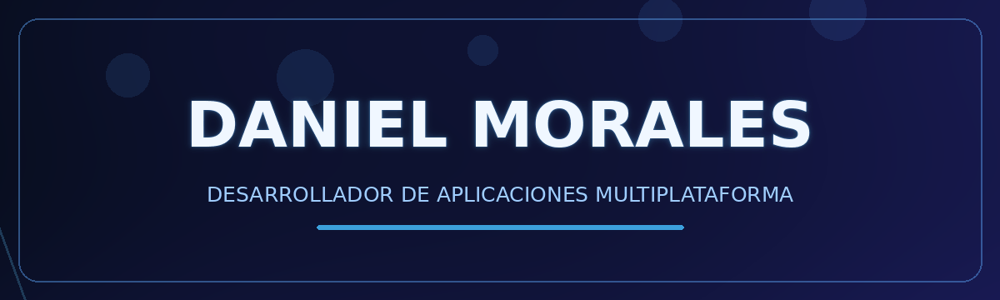

### Desarrollador de Aplicaciones Multiplataforma

Estudiante de DAM en Málaga · 2025–2027

---

## Sobre mí

Soy estudiante de **Desarrollo de Aplicaciones Multiplataforma** en Davante Medac Nova (2025–2027), en Málaga.

Trabajo principalmente con Java, Kotlin, Python y SQL. También tengo conocimientos de desarrollo web y me interesan especialmente las bases de datos, el testing, la ciberseguridad y la inteligencia artificial.

He realizado unas 360 horas de formación complementaria en OpenWebinars. Actualmente busco prácticas en desarrollo de aplicaciones para seguir ganando experiencia y aplicar lo aprendido.

## Tecnologías

**Lenguajes**

**Desarrollo web**

**Herramientas y entornos**

**Ofimática**

## Formación

**Grado Superior en Desarrollo de Aplicaciones Multiplataforma**  
Davante Medac Nova · 2025–2027

**Formación complementaria — OpenWebinars (360 horas)**

- Java y SQL.
- HTML5 y CSS3.
- Testing y Kanban.
- Onboarding en Ciberseguridad.
- IA para Ciberseguridad.
- Fundamentos de la IA.

## Intereses

- Desarrollo de aplicaciones multiplataforma.
- Desarrollo web y full stack.
- Bases de datos y testing.
- Ciberseguridad e inteligencia artificial aplicada a la seguridad.

## Proyectos

## Actividad en GitHub

<picture>
  <source media="(prefers-color-scheme: dark)" srcset="https://raw.githubusercontent.com/Dmorflo23/Dmorflo23/output/github-snake-dark.svg">
  <source media="(prefers-color-scheme: light)" srcset="https://raw.githubusercontent.com/Dmorflo23/Dmorflo23/output/github-snake.svg">
  
</picture>

## Idiomas

- Español: nativo.
- Inglés: B2 (Cambridge).

**Gracias por visitar mi perfil. ¡Conectemos!**
